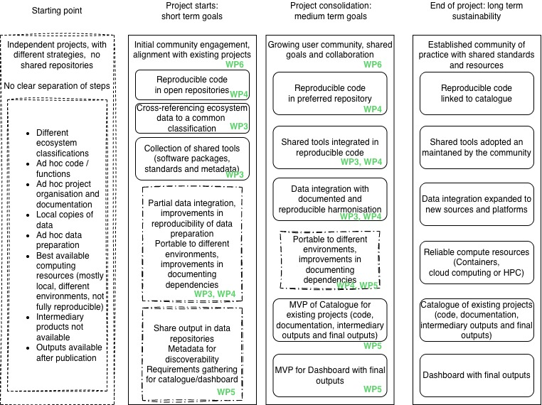

# Updates on Work Packages {background-image="https://live.staticflickr.com/65535/54677183355_507c3f313d_b.jpg"}


## WP1 — Establishment Activities

```{mermaid}
%%| fig-width: 6.5
%%| fig-align: center
%%| file: fig/WP1-Oct26.mmd
%%| fig-responsive: false
```

## Recent additions to our Core Team

::::{.columns}
:::{.column}
{.circle-img height=300}
:::
:::{.column}
 {.circle-img height=300px}
:::
::::


## New members of the Steering committee

- Chris Okey, DCCEW Representative, DCCEW, Standing Guest
- Shandiya Balasubramaniam, Project: Mobilising Enriched Datasets, ALA


## WP 2 — Requirements gathering

```{mermaid}
%%| fig-width: 6.5
%%| fig-align: center
%%| file: fig/WP2-Oct26.mmd
%%| fig-responsive: false
```

## Workflow development plan

<https://ecosystem-indicators-workflows.github.io/EIW-development-plan/>

- Workflows with user-defined scope and consistent structure
- Aligned with Global Ecosystem Typology and FAIR principles
- 10 primary user groups and 9 primary use cases
- Roadmap with two development tranches:
  - First tranche (May to Nov 2026), reduced in scope due to delays in WP1
  - Second tranche (Jan to Nov 2027)

## Roadmap overview {.smaller}

| Theme                  | Use cases | Tranche 1 | Tranche 2       | Dependencies |
| ---------------------- | --------- | ----------|--------- |--------- |
| Workflow development   | UC01 UC02   | Priority  | Enhance  | WP3 |
| Workflow adaptation    | UC03 UC04   | Explore   | Priority | WP3 |
| Workflow publication   | UC05       | Explore   | Priority |     |
| Integration in assessments | UC06   | Explore   | Explore |     |
| Discoverability        | UC07       | Initial   | Expanded | WP5 |
| Training               | UC08       | Initial   | Expanded | WP6 |
| Applications           | UC09      |           | Explore | |
| FAIR & PID             | All      | Initial   | Full implementation | WP2 |

## PID and FAIR implementation plans

- Both shared with Steering Committee members
- Identified different project assets: Datasets, software packages, computational workflows, and controlled vocabularies 
- Identified recommended FAIR frameworks for each group
- Living documents summarising current vision
- Will be adapted and refined as the project advances

## WP 3 — Data and Metadata

```{mermaid}
%%| fig-width: 6.5
%%| fig-align: center
%%| file: fig/WP3-Oct26.mmd
%%| fig-responsive: false
```

## GET vocabulary

- <https://w3id.org/iucn-get/IUCNEcosystemTypology>
- Discussions with DCCEEW vocabularies working group
- GET Scientific Committee


## Ecosystem distribution data

Work in progress with the ARC Laureate team (David Keith, Mark Tozer and Sylvia Hay) and CSE team (Arash Shaghaghi and Nimesha Wickramasinghe)

- Catalogue of sources
- Tools for cross-referencing (R package and EcoID tool)
- Synthesis map of Australian terrestrial ecosystems

## WP 4 — Workflow delivery

```{mermaid}
%%| fig-width: 6.5
%%| fig-align: center
%%| file: fig/WP4-Oct26.mmd
%%| fig-responsive: false
```

## Workflow delivery

- Implementation of Workflow development plan
- Current focus on first tranche of workflow functionality, with priorities:
  - *UC01 – Adapt an existing fit-for-purpose ecosystem-specific indicator to make it reproducible*
  - *UC02 – Develop a new fit-for-purpose ecosystem-specific indicator*
- Initial implementation of PID and FAIR

## WP 5

```{mermaid}
%%| fig-width: 6.5
%%| fig-align: center
%%| file: fig/WP5-Oct26.mmd
%%| fig-responsive: false
```


## Requirements gathering

- To be started in Nov 2026
- Plan to engage with end users through focus groups
- Plan will be shared with SC members late October
- Team will approach SC members for input on identifying key contacts

## WP 6 — Comm & Engagement

```{mermaid}
%%| fig-width: 6.5
%%| fig-align: center
%%| file: fig/WP6-Oct26.mmd
%%| fig-responsive: false
```

## Deliverables for November

- *WP 6.1 Communication and engagement plan* was shared in the second SC meeting in June, awaiting SC approval
- At the June meeting the SC agreed *WP 6.5 Published data/code outputs for workshop participants* would be reported as "in progress" for Milestone 2

## Comm & engagement activities

- Presentation at Research Software Asia Australia Conference (RSAA26) (24 Aug 26)
- Poster and Birds of a Feather session at eResearch (24 Oct 26) 
- Symposium at ESA 2026: [Advancing an Ecosystem Approach for Nature-Positive Futures](https://nectarcc-esa-2026.eventsairsite.com/program) (2 Dec 26)

## Comm & engagement activities

A series of community events has been designed to align with the Workflow development plan (WP2.1), this will allow more effectively linking engagement activities with specific project milestones.  

# Project sustainability {background-image="https://live.staticflickr.com/65535/53488067619_72e04e487f_b.jpg" background-color="black"}

##



# Thanks! {background-image="https://live.staticflickr.com/65535/54676036502_07d648f4ab_b.jpg" background-color="black"}


##  {.smaller background-image="https://live.staticflickr.com/65535/54676036502_07d648f4ab_b.jpg" background-opacity="0.3"}

This presentation was prepared by José R. Ferrer-Paris and is shared under license: [Attribution-ShareAlike 4.0 International (CC BY-SA 4.0)](https://creativecommons.org/licenses/by-sa/4.0/deed)

::: panel-tabset
### Links

It was created using  [Quarto](https://quarto.org/docs/presentations/), [Mermaid](https://mermaid.js.org/), [Graphviz](https://graphviz.org/) and [reveal.js](https://revealjs.com/). 

Slides are available at:

[rpubs.com/jrfep](https://rpubs.com/jrfep/ecosystem-indicator-workflows).

Source code available at:

[github/Ecosystem-Indicators-Workflows/](https://github.com/Ecosystem-Indicators-Workflows/project-presentations).

### Images and figures

Photos from:


Flickr images: - ["Fuente"](https://flic.kr/p/2riwYLw), ["Paseo por Bundeena"](https://flic.kr/p/2puyk1p) and ["La Ruta"](https://flic.kr/p/2riCRFR) by [José Rafael Ferrer-Paris](https://www.flickr.com/photos/199798864@N08/)

Other diagrams created with Graphviz and Mermaid for the ARDC Ecosystem Indicators Workflow project [@ARDC_2026_EIW], with source code shared under the CC BY-SA 4.0 license.

### References

::: {#refs}
:::

:::
